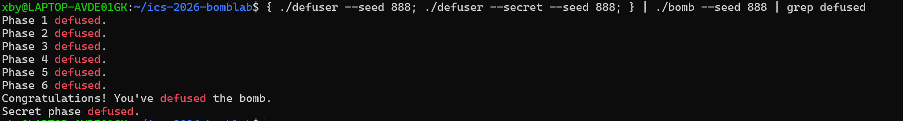
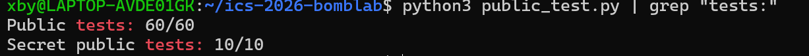

# ICS Lab2 BombLab 实验报告

## 1. 辅助工具说明
在分析汇编、理解 GDB 调试指令以及排查编译警告时，使用了 AI 工具辅助梳理思路。所有代码逻辑均经过本人推导，并在本地通过 `make` 编译及 `public_test.py` 严格测试验证。引用的资料主要为 CS:APP 教材。

## 2. 各关卡分析与推理过程

### Phase 1：基本运算与寄存器传参
- **关键汇编**：入口处 `rsi` 指向 challenge。指令包括 `shr`（右移）、`xor`（异或）、`and`（与操作）。
- **恢复的计算关系**：将 challenge 拆分为 64 位与 32 位的不同部分，经过位移掩码后，进行 `step0 = (low * 5) ^ (high + 0x37c5)` 等多次组合运算，最后得出单个整数输出。

### Phase 2：循环与递推
- **关键汇编**：存在一个明显的循环结构，每次通过 `and $0x1F` 提取 5 位，通过 `shl` 和 `add` 更新下一次迭代的数据。
- **恢复的计算关系**：读取 challenge 的不同位段（每 5 位），第一个数提取后 `+5`，后续 5 个数满足递推公式：`values[d] = (part ^ d) + 4 * values[d - 1]`，共输出 6 个整数。

### Phase 3：Switch 跳转表
- **关键汇编**：`and $0x7,%edi` 后，通过 `notrack jmp *0x405820(,%rax,8)` 进行间接跳转，典型的 Switch 跳转表结构。
- **恢复的计算关系**：第一个输入必须等于 `challenge & 7`。根据跳转表映射，通过 `x = (challenge >> 32) ^ (challenge >> 3)` 计算 `x`，然后代入对应 `case` 的公式（如 `(x ^ 0x1769) + (x >> 1)` 等）得出第二个整数。

### Phase 4：递归与二分查找
- **关键汇编**：`call 402320 <p4_walk>`，且在函数内部再次 `call` 自身，并伴有 `cmp` 和条件跳转（`jb`）。
- **恢复的计算关系**：本质是一个在 `0` 到 `0x7f` 范围内寻找目标值的二分查找。每次递归计算中点 `mid`，如果 `target < mid` 则向左递归并乘以 3 异或标志位，否则向右递归。

### Phase 5：结构体与链表遍历
- **关键汇编**：在内存中通过基址 + 索引（比例变址寻址 `%rax,8`）访问节点。
- **恢复的计算关系**：根据 challenge 低 3 位选出初始节点，遍历步数由 `(challenge >> 3) & 3` 决定。每次遍历执行 `eax = eax * 3 + node->c` 然后异或 `node->b`。最后输出计算结果和特定节点的 `b` 值。

### Phase 6：函数指针表与循环移位
- **关键汇编**：`call *%rax`，通过函数指针数组 `p6_table` 调用不同的操作函数，函数内部包含 `rol` 和 `ror`（循环左移/右移）指令。
- **恢复的计算关系**：根据 challenge 的低 3 位和次低 3 位分别选择两次不同的函数。传入参数依次进行运算：`r1 = op1(arg)`，`r2 = op2(r1 ^ 0xfa14)`，最后结果加上 `0x7a39` 输出 1 个整数。

### Honor (Secret Phase)
- **关键汇编**：涉及字符拷贝和格式化输出。
- **恢复的计算关系**：通过提取前六关得到的 `context` 和当前 `challenge` 的各个位段，计算出三个整数 `a, b, c`，最后通过 `snprintf` 拼接成包含 `"OPEN"` 前缀的完整字符串。

## 3. 非公开 Seed 验证记录

除了公开测试的 seed，我使用了非公开的 `seed 888` 进行本地验证，成功解除全部关卡及 Secret Phase。

> **注**：由于炸弹程序在运行时会输出大量的背景剧情文字，原始终端输出过长。为了报告的简洁清晰，截图时使用 `grep defused` 过滤了非必要输出，仅保留通关提示。

## 4. 公开测试运行结果

本地运行 `python3 public_test.py`，全部测试通过（正式关卡 60/60，Honor 10/10）：

